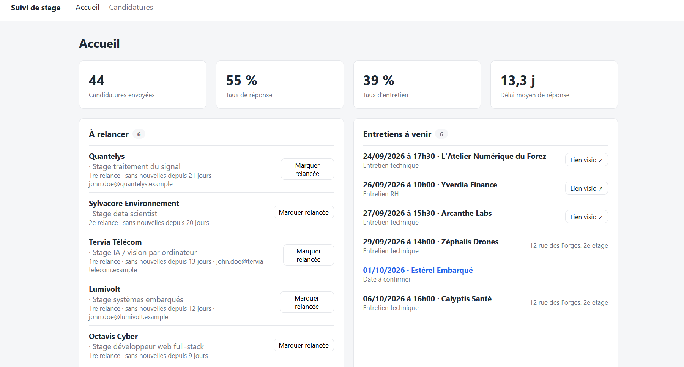
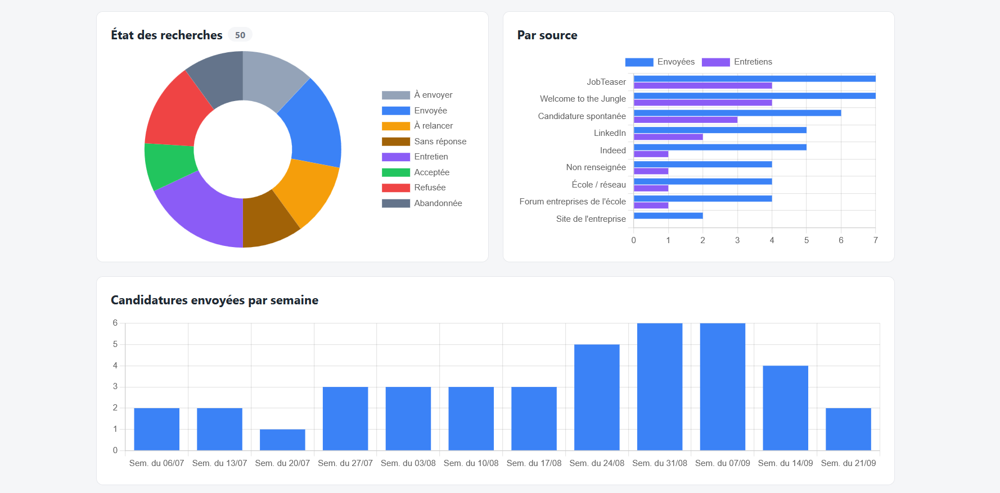
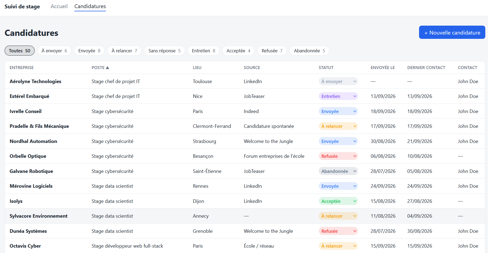
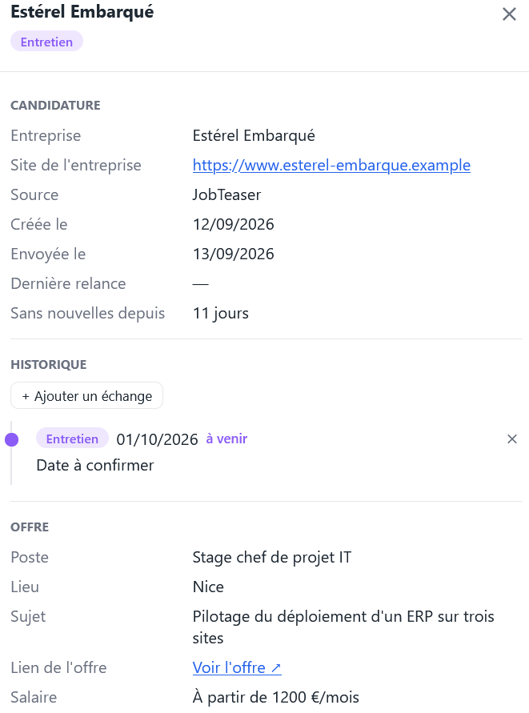
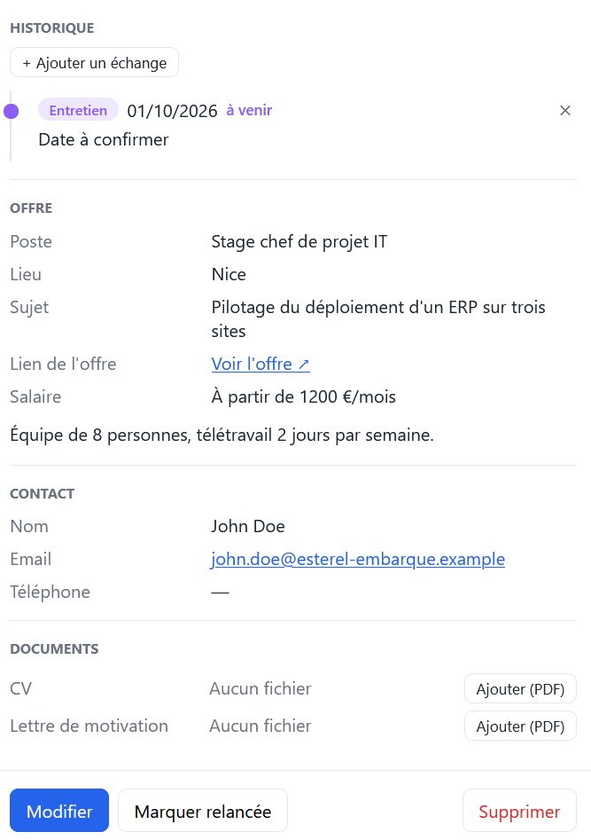

# Suivi de stage

Un mini-CRM personnel pour suivre ses candidatures de stage : où on a postulé, qui relancer et quand, et ce que donnent les recherches.

Application web en Python (FastAPI), rendue côté serveur, pensée pour un seul utilisateur et lancée en local. 
Pas de base de données : tout tient dans quelques fichiers JSON.

## Aperçu

**Accueil** : chiffres clés, candidatures à relancer et entretiens à venir, puis les graphiques.





**Tableau des candidatures**, filtrable par statut et triable par colonne.



**Fiche latérale** d'une candidature : détails, historique des échanges, contact et documents.

| | |
|---|---|
|  |  |

## Fonctionnalités

- **Tableau des candidatures**, filtrable par statut (plusieurs à la fois) et triable par colonne. Un clic sur une ligne ouvre une fiche latérale pour consulter, modifier ou supprimer la candidature sans quitter la page.
- **Relances automatiques par paliers.** Une candidature envoyée restée sans nouvelles passe « À relancer » au bout de 7 jours, puis encore 14 jours après la 1re relance. Une fois les relances prévues épuisées, elle passe « Sans réponse ». Le bouton « Marquer relancée » enregistre la relance.
- **Historique des échanges** pour chaque candidature : envois, relances, réponses, appels, entretiens (avec l'heure et le lieu ou le lien visio) et notes. Les entretiens à venir remontent sur la page d'accueil.
- **Statistiques** sur l'accueil : taux de réponse, taux d'entretien, délai moyen de réponse, et trois graphiques (répartition par statut, résultats par source, candidatures envoyées par semaine).
- **Documents** : le CV et la lettre de motivation envoyés, en PDF, rattachés à chaque candidature et consultables dans le navigateur.
- **Sources mémorisées** : on choisit une source dans la liste (LinkedIn, Indeed…) ou on en tape une nouvelle, qui est retenue pour la suite.

## Stack

- **Back-end** : Python 3.14, FastAPI, Pydantic, Jinja2
- **Front-end** : HTML/CSS et JavaScript sans framework, [Chart.js](https://www.chartjs.org/) pour les graphiques
- **Stockage** : fichiers JSON et PDF sur disque

## Architecture

Le code est découpé en couches, qui ne communiquent que par ce qu'elles se renvoient, 
sans rien savoir du fonctionnement les unes des autres.

```
app/
├── controllers/   routes HTTP : pages complètes et actions de formulaire
├── services/      règles métier (relances, statuts) et statistiques
├── dao/           lecture / écriture des fichiers JSON et PDF
├── models/        modèles Pydantic : Candidature, Evenement, statuts
├── schemas/       validation des formulaires HTML
├── templates/     pages Jinja2 (les partiels commencent par _)
├── static/        CSS et JavaScript
└── config.py      délais de relance, taille max des PDF, sources par défaut
```

### Choix techniques

- **Rendu côté serveur et POST/redirect/GET.** Chaque action (créer, modifier, relancer…) est un formulaire POST suivi d'une redirection. Pas d'API JSON ni de framework front : moins de code, et le bouton « Actualiser » ne renvoie jamais un formulaire.
- **Persistance isolée dans la couche DAO.** Le reste du code ignore que les données sont en JSON. Pour passer à une vraie base, il suffit de réécrire les DAO en gardant les mêmes méthodes.
- **Écriture atomique.** Chaque sauvegarde écrit d'abord un fichier temporaire, puis le renomme. Un plantage en pleine écriture ne corrompt pas les données.
- **Statut de relance calculé à la lecture.** « À relancer » et « Sans réponse » sont déduits de la date du dernier contact et du nombre de relances. Ils ne sont jamais stockés, donc jamais périmés.
- **Relances déduites de l'historique.** Le nombre de relances et la date de la dernière sont calculés à partir des entrées de l'historique, pas stockés à part.
- **Filtre et tri dans le navigateur.** Le tableau se filtre et se trie instantanément, sans rechargement. Le choix est mémorisé d'une visite à l'autre.
- **Vérification des PDF.** Le serveur contrôle le contenu réel du fichier (en-tête `%PDF-`) et sa taille, pas seulement l'extension.

## Installation et lancement

Prérequis : Python 3.14 (ou une version récente de Python 3).

```bash
git clone https://github.com/MatDeck/crm_stage.git
cd crm_stage

python -m venv .venv
# Windows
.venv\Scripts\activate
# macOS / Linux
source .venv/bin/activate

pip install -r requirements.txt
uvicorn app.main:app --reload
```

L'application est alors disponible sur <http://127.0.0.1:8000>.

## Configuration

Les réglages sont dans `app/config.py` :

| Constante | Valeur par défaut | Rôle |
|---|---|---|
| `DELAIS_RELANCE_JOURS` | `[7, 14]` | Jours d'attente avant chaque relance. Ajouter une valeur ajoute une relance. |
| `DELAI_SANS_REPONSE_JOURS` | `14` | Jours sans nouvelles, après la dernière relance, avant de passer « Sans réponse ». |
| `TAILLE_MAX_DOCUMENT_MO` | `10` | Taille maximale d'un PDF, en Mo. |
| `SOURCES_PAR_DEFAUT` | LinkedIn, Indeed… | Sources proposées au premier lancement. |

## Données

Tout est enregistré dans le dossier `data/`, créé au premier enregistrement :

- `candidatures.json` : les candidatures et leur historique
- `sources.json` : les sources connues
- `documents/<id>/` : les PDF de chaque candidature

Ce dossier contient des données personnelles. Il est exclu du dépôt par le `.gitignore`. Pour faire une sauvegarde, il suffit de le copier.
